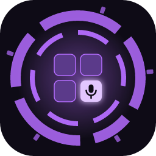
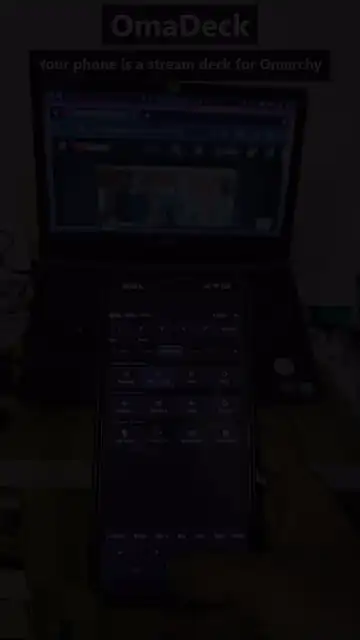
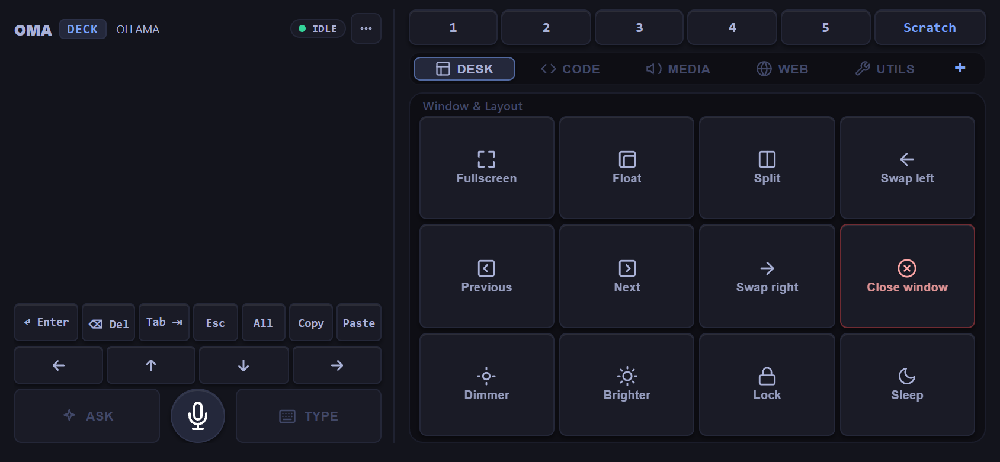
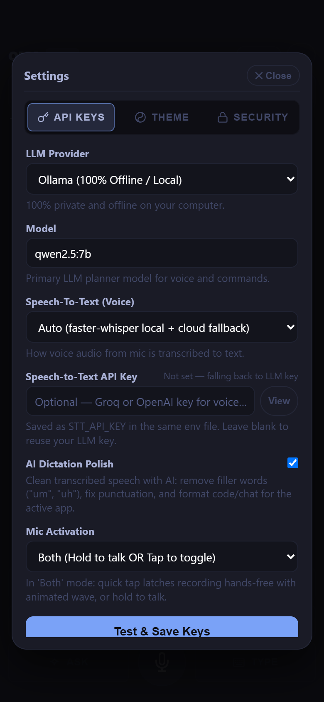
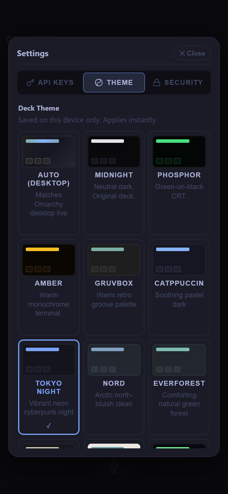

<p align="center"></p>

<h1 align="center">OmaDeck</h1>

<p align="center">A phone remote and voice control for Omarchy and Hyprland: workspaces, windows, media, typing, and an AI that runs what you say.</p>

[](https://github.com/Mohsintl/omadeck/actions/workflows/ci.yml)
[](LICENSE)
[](https://github.com/Mohsintl/omadeck/releases/latest)

<div align="center">



*Sped up: voice commands, killing `:3000`, a key of your own that runs three steps, workspaces and media, all from an iPhone. [Full tour of every tab (MP4, 1 min 48 s)](docs/media/omadeck-tour.mp4).*

</div>

## Install

### On the PC

```bash
git clone https://github.com/Mohsintl/omadeck.git && cd omadeck && ./install.sh --quick
```

`--quick` installs the phone deck and nothing else, asks no questions, and ends by showing a QR code. Tapping and typing work straight away; voice and AI can wait until later, in the deck's Settings or `omadeck settings` on the PC.

Needs Omarchy, or Arch with Hyprland, plus `hyprctl` and `wtype`, and Python 3.11 or newer. The phone and the PC on the same Wi-Fi, or the same Tailscale network. The deck listens on port `8765`. Everything installs under your home folder; `sudo` is only for packages, and [uninstalling](#uninstall) removes all of it.

Run `./install.sh` without `--quick` to choose each part yourself, including the extras: the voice daemon and its service, the bar widget, the `omarchy voice ...` commands, and the SUPER + SHIFT + V keybinding. Run it again at any time to add them.

### On the phone

`omadeck mobile` prints the pairing link, and a QR code when `qrencode` is installed:

```text
  Scan this with your phone's camera. It walks you through the rest:
  the certificate (once per phone), opening the deck, and adding it
  to your Home Screen.
    [QR code]
    http://192.168.1.50:8765/pair#token=<token>
    Certificate fingerprint: 8A:3F:B2:91:...
    Keep this link private: anyone with it can control your desktop.
```

Scan it: the page that opens installs the certificate, checks that the phone trusts it, then opens the deck over HTTPS. Browsers only hand the microphone to a page over HTTPS, so the certificate is trusted once per phone. To do that part by hand, open `http://<your-pc-lan-ip>:8765/ca.crt`:

- **iPhone and iPad:** **Settings → Profile Downloaded → Install**, then **Settings → General → About → Certificate Trust Settings** and turn on full trust for "Oma Remote CA".
- **Android:** **Settings → Security → Encryption & credentials → Install a certificate → CA certificate**. A CA certificate, not "VPN & app" and not "Wi-Fi".

Then open the `https://` link, or scan the QR code again. If the browser warns that the connection isn't private, the certificate isn't trusted yet: do the steps above instead of tapping through.

The last step is installing the deck as an app: **Share → Add to Home Screen** in Safari, **⋮ → Install app** in Chrome. "Add to Home screen" in Chrome only makes a shortcut that keeps the address bar.

The token sits after the `#`, which the phone never sends over the network. Treat the link and the QR code like a password anyway: anyone holding them can control your desktop. The service log leaves the token out and prints only the certificate fingerprint.

`qrencode` is optional and the links work without it; `sudo pacman -S qrencode` adds it.

### Upgrading from 0.5.0

```bash
cd omadeck && git pull && ./install.sh --update && omadeck restart
```

`omadeck update` arrives in 0.6.0 and does those three steps from now on. On iPhone, remove the Home Screen icon and add it again for the new icon and name.

## What you get

**A dock under your thumb.** **Ask** runs a typed command, the **mic** runs a voice command, **Type** types into the focused PC window. Each opens one panel above the dock instead of taking over the screen. Quick keys and arrows you can hold to repeat sit just above it, and `⋯` has Edit deck, where you hide and reorder keys and pick the quick keys, saved on that phone.

**Tabs, with the keys already on them.** Tap a workspace number to go there, hold it to move the focused window there. Workspaces 1–5 and Scratch sit above every tab.

| Tab | Keys |
|:---|:---|
| **Desk** | Fullscreen, float, split, previous/next window, swap left/right, close window, dimmer/brighter, lock and sleep. |
| **Code** | Git status, diff, pull and push; kill `:3000` and `:8000`; `Ctrl+C`, suspend, clear; run tests, new terminal, terminal copy/paste. |
| **Media** | Previous, play/pause, next and stop, YouTube included; volume, mute, switch audio output; PC mic mute, screenshot, app menu. |
| **Web** | Back, forward, scroll, previous/next tab, new tab, close tab, address bar, reload, zoom. |
| **Utils** | btop, T3 Code, Inspector, Lazygit, lazydocker, OpenCode, Kill app (point a crosshair at any stuck window and end it), Zen mode, Caffeine, Night light, Clipboard history, system menu. |
| **Yours** | Tap **+** to make a tab of your own: keys that run a deck button, type text, press a key combo, or run Steps in order. New terminal → wait 1 s → type `cd omadeck && omadeck update` ↵. Deck keys run on the PC without the AI, so they cost no tokens. |

**Obvious commands skip the AI.** "Volume to max", "volume 40 percent", "turn it up a bit", "focus the address bar", "select all", "undo", and every description in Omarchy's Super+K keybinding list ("toggle nightlight", "color picker", "focus on left window") run straight away, from the phone or the PC mic, with no tokens. "Hey Oma", "please" and "can you" get dropped. Everything else goes to the AI, and `omadeck log` marks which way each command went.

**Themes that follow your desktop.** The deck matches your active Omarchy theme, or you pick one of the built-in ones yourself.

<div align="center">



*In landscape there's room for the log and the command box beside the keys, so a phone propped next to your keyboard works like a deck of its own.*

</div>

## Settings and AI keys

`omadeck settings` on the PC and the gear on the phone open the same panel: provider, keys, mic behaviour, theme.

- Pick a provider: **Groq**, **Ollama**, **OpenAI**, **OpenRouter**, **DeepSeek**, **Mistral**, **NVIDIA**, or a custom OpenAI-compatible endpoint such as vLLM or LM Studio.
- Paste the key, then **Test & Save Keys** checks it before saving. Keys live in `~/.config/omarchy-voice/env` with `chmod 600`.
- Speech-to-text has its own key (`STT_API_KEY`), so a local model can run with cloud transcription, or everything stays local with `faster-whisper`.
- Choose how the mic starts: hold to talk, tap to talk, or both. Dictation can strip filler words ("um", "uh") and fix punctuation before it types.

<div align="center">




</div>

## Security

OmaDeck types and clicks on your desktop, so it is a keyboard lying on your network. It's built for a network you trust: anyone holding the pairing link can control your desktop. Never port-forward `8765`. Away from home, use Tailscale or WireGuard. On shared Wi-Fi, set a PIN in Settings → Security.

**In place.** Shell access is off by default (`allow_shell = false`), so the assistant can't run commands or press Enter in a recognised terminal. For two minutes after it reads a screen, terminal, page or clipboard, commands and saved notes need your spoken confirmation. PINs and API keys are refused over plain HTTP when HTTPS is available. PIN guesses are rate limited, connections are capped per address, and slow clients are cut off.

**Known limits.** Touch controls still work over plain HTTP, so a phone without the certificate sends its token and commands unencrypted. Prompt injection is reduced, not solved: text on a page can still steer ordinary clicks and typing. The command denylist isn't a sandbox. The terminal guard goes by window type, so it misses terminals built into editors. Someone on your network can block PIN login for up to 24 hours by failing it repeatedly, though your pairing link keeps working.

Found a security problem? Please see [SECURITY.md](SECURITY.md).

## What I've tested

Omarchy with Hyprland 0.56.2, on iPhone and iPad with Safari, and on Android with Chrome (Redmi Note 9 Pro Max). Other Hyprland setups and other Android phones should work but haven't been tried, so reports are welcome in the [issues](https://github.com/Mohsintl/omadeck/issues).

Everything works offline with local models; voice and AI results are just less accurate than with a cloud API.

The phone deck has end-to-end tests that open it in a phone-sized browser, tap the keys and check what reached the desktop. The desktop is fake: `hyprctl` and `wtype` stand-ins log each call, so the tests run on any machine, and CI runs them on every pull request next to 400+ unit tests. They're also written up as a [community example on e2e](https://e2e.com/examples/omadeck); to run them yourself, see [`e2e/README.md`](e2e/README.md).

## Commands

```bash
# Show your pairing link
omadeck mobile

# Pull the latest OmaDeck, reinstall it and restart
omadeck update

# Restart everything (the voice daemon and the phone page)
omadeck restart

# What it heard, what the AI did, and every phone button press, live
omadeck log -f

# Check every moving part
omadeck doctor

# Try a command without speaking
omadeck say "go to workspace 2"
```

### Updating

`omadeck update` pulls the folder you installed from, copies the new code into place and restarts, without asking the installer's questions again. Your settings, keys and pairing stay. It stops without changing anything if that folder has changes you haven't committed.

The services run a copy of the code, so `git pull` on its own changes nothing. If you installed before `omadeck update` existed, do it the long way once:

```bash
cd omadeck
git pull
./install.sh --update
omadeck restart
```

After that, `omadeck update` works.

## Troubleshooting

Start with `omadeck doctor`, which checks every moving part, and `omadeck log -f`, which shows each button press and voice command as it happens.

| What you see | What to do |
|:---|:---|
| The deck loads on the PC but times out on the phone | The firewall is probably blocking it. Omarchy turns on `ufw`, so allow the port with `sudo ufw allow 8765/tcp`. `omadeck mobile` warns about this when it spots it. Also check that the phone is on the same Wi-Fi, not mobile data. |
| The browser warns that the connection isn't private | The certificate isn't trusted yet. Scan the QR code from `omadeck mobile` again and follow the certificate steps above; on iPhone, also turn on full trust in **Settings → General → About → Certificate Trust Settings**. Don't tap **Proceed** on the warning. |
| Android has no **Install app**, or the app opens with a Chrome bar | Chrome doesn't trust the certificate: tap the icon left of the address, which must say **Connection is secure**. Install the certificate as a **CA certificate** (not VPN & app or Wi-Fi), clear any old Proceed in Chrome's **⋮ → Settings → Site settings → All sites → your PC → Clear & reset**, then reinstall with **⋮ → Install app**. |
| The mic doesn't work | Browsers only allow the mic over HTTPS. Open the `https://` link, not the `http://` one, after installing the certificate. |
| The deck asks for the "Desktop Pairing Token" | The link is missing its `?token=...`, or the token changed. Scan the QR code from `omadeck mobile` again. |
| The Home Screen icon is a plain letter or the old logo | Run `omadeck update`, remove the icon from the Home Screen and add it again; iOS keeps the old one. |
| Buttons do nothing on the PC | Check that `hyprctl` and `wtype` are installed, then run `omadeck restart`. `omadeck log` shows each command it ran and why one failed. |
| `sudo` fails in a terminal opened from the deck | Run `omadeck update`: older versions started terminals inside the service's sandbox, where sudo can't run. |

Still stuck? [Open an issue](https://github.com/Mohsintl/omadeck/issues) with the output of `omadeck doctor`.

## Uninstall

```bash
cd omadeck
./uninstall.sh
```

It stops and removes the services, the `omadeck` command, the installed code, the bar widget and the keybinding it added. It backs up `bindings.lua` and `shell.json` before changing them. Your settings, API keys and certificates stay in `~/.config/omarchy-voice`, so a re-install keeps your pairing.

To remove those as well:

```bash
./uninstall.sh --purge
```

Then delete the "Oma Remote CA" certificate from your phone: on iPhone, **Settings → General → VPN & Device Management**.

## Roadmap and contributing

[ROADMAP.md](ROADMAP.md) has what's planned. [CONTRIBUTING.md](CONTRIBUTING.md) covers local development and tests. Ideas and bugs go in the [issue tracker](https://github.com/Mohsintl/omadeck/issues).

## Credits

Built on [Omarchy](https://omarchy.org) and the [Hyprland](https://hyprland.org) Wayland compositor. The foundations and the Hyprland Lua dispatching started from [omarchy-voice](https://github.com/wombatoperator/omarchy-voice) by Britain Eriksen. OmaDeck is mentioned in [Awesome Omarchy](https://github.com/aorumbayev/awesome-omarchy#development-tools).

## License

[Apache License 2.0](LICENSE).
