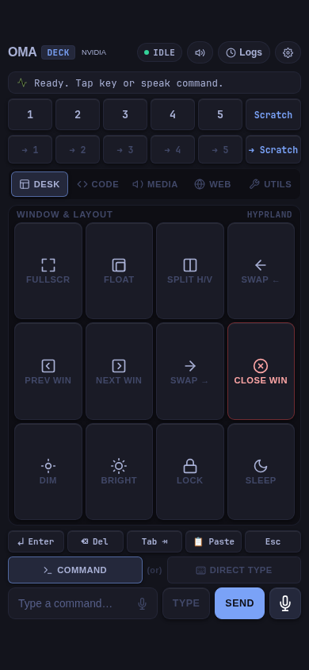
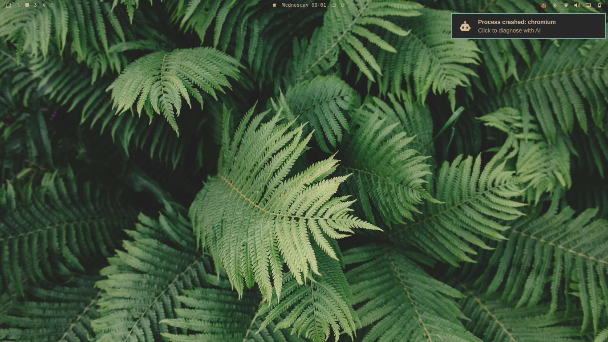
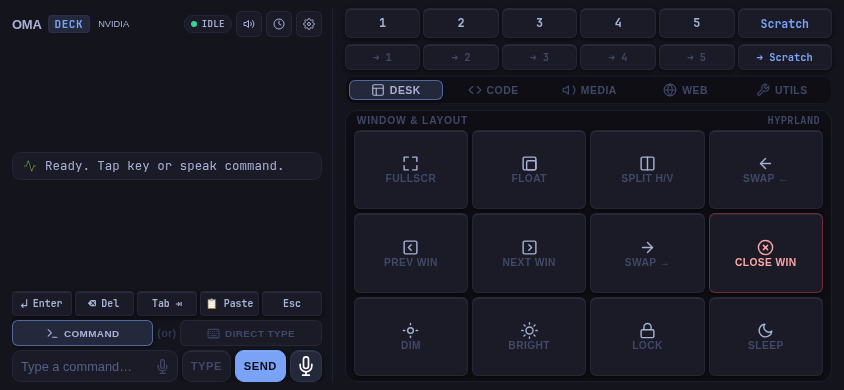
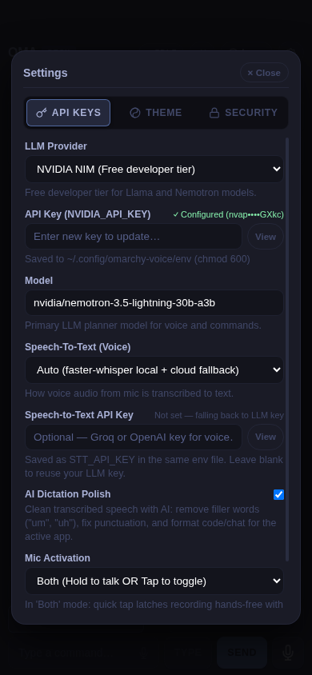
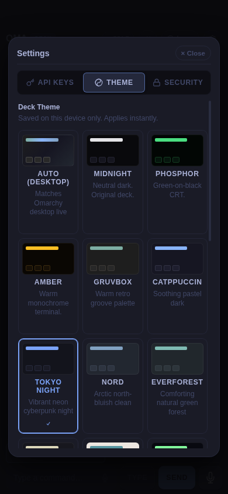

# 🎮 OmaDeck

[](LICENSE)
[-blue)](#)
[](#)
[](#)
[](ROADMAP.md)

> **Tactile PWA Mobile Remote Deck & Universal AI Voice Companion for Omarchy / Hyprland Linux**

<div align="center">

| 📱 Mobile Touch Remote (Portrait) | 💻 Linux Desktop (Hyprland / Omarchy) |
| :---: | :---: |
|  |  |

*OmaDeck running in Tokyo Night theme: tactile quick keys, inline dictation mic, instant workspace switching, and direct PC typing.*

</div>

[🚀 Quick Start](#-quick-start) • [💡 Why OmaDeck?](#-why-omadeck) • [📱 Profiles](#-five-dedicated-touch-profiles) • [⚙️ AI Setup](#️-interactive-settings--ai-configuration) • [🗺️ Roadmap](ROADMAP.md) • [🤝 Contributing](CONTRIBUTING.md)

---

### ⚡ At a Glance

| Question | Details |
|:---|:---|
| **What is it?** | A self-hosted Web App (PWA) that acts like a physical Stream Deck + AI voice remote for Linux. |
| **Who is it for?** | Omarchy, Arch Linux, and Hyprland users who want tactile desk control or couch remote power. |
| **Why not a physical deck?** | Physical decks cost $150+, have fixed buttons, and lack Wayland awareness. OmaDeck uses your existing phone, has 5 context profiles, OLED themes, and direct PC voice typing. |
| **Supported Devices** | Any phone or tablet with iOS Safari (iOS 16.4+) or Android Chrome. Zero app store installs. |
| **Privacy & Connection** | 100% Local LAN HTTPS with token/PIN authentication. Fully functional offline with Ollama. |

---

## 💡 Why OmaDeck?

Most Linux remote tools are either clunky VNC viewers that eat battery, or single-purpose media remotes that can't interact with modern Wayland compositors.

| The Problem | How OmaDeck Solves It |
|:---|:---|
| Reaching for the keyboard just to switch workspaces or adjust volume while relaxing. | **One-tap touch grid**: Instant Hyprland workspace jumps, window moves, and scratchpad toggles. |
| Typing long URLs, prompts, or text on the PC from across the room. | **Direct PC Typing**: Type or dictate via your phone's native speech keyboard straight into the focused PC window. |
| A dev server or port `:3000` is hanging your system. | **One-tap Process Killer**: Kill `:3000`, `:8000`, or launch the crosshair window terminator with 1 tap. |
| Physical macro pads cost $150+ and require proprietary drivers. | **Zero Hardware Cost**: Turn any spare or current phone into an OLED macro board with haptic feedback. |
| Most AI voice assistants send everything to a proprietary cloud. | **Universal AI Engine**: Bring your own Groq, Ollama (100% local/offline), OpenAI, DeepSeek, or custom endpoint. |

```
       📱 Phone / Tablet (PWA)                     💻 Omarchy Linux Desktop (PC)
  ┌────────────────────────────────┐         ┌──────────────────────────────────────┐
  │  [Desk] [Code] [Media] [Utils] │ ──LAN──▶│  • Instant Workspace & Window Switch │
  │  ⌨️ Direct PC Typing (iOS mic) │  HTTPS  │  • Terminal TUIs (OpenCode, Lazydock)│
  │  🎙️ Tactile Hold-to-Talk AI    │  (8765) │  • Audio / Media / Brightness / Apps │
  │  ⚡ Process Killer & Dev Tools │         │  • Hyprland Lua Dispatcher Engine    │
  └────────────────────────────────┘         └──────────────────────────────────────┘
```

---

## 🌟 Highlights

- **📱 Touch Remote Deck (PWA)**: Calibrated for zero-scroll viewport precision across both portrait (e.g. 390×844) and landscape (844×390). Add to iOS or Android Home Screen for an instant fullscreen hardware deck experience with tactile haptic feedback.
- **⌨️ Direct PC Typing & Always-On Key Bar**: Type directly into whatever browser bar, code editor, or terminal window is focused on your Linux desktop with persistent auxiliary keys (`↵ Enter`, `⌫ Del`, `Tab ⇥`, `📋 Paste`, `Esc`).
- **🎙️ Inline Speech Dictation & AI Polish**: Dedicated dictation mic inside the input bar with intelligent Amical-style cleanup (strips filler words like "um", "uh", fixes punctuation, and applies context-aware formatting based on active window class).
- **🕹️ Hold, Tap, or Hybrid Mic Activation**: Choose between Push-to-talk (hold to speak), Hands-free latch (tap to start/stop), or Both (hybrid tap/hold) with radar pulse and live sound-wave visualizers.
- **🤖 Universal AI Model Support**: Works with **any** modern LLM provider:
  - **Groq** (Ultra-fast 500+ tok/s with Llama 3.3 70B)
  - **Ollama** (100% offline, local & free)
  - **OpenAI** (gpt-4o / gpt-4o-mini)
  - **OpenRouter**, **DeepSeek**, **Mistral**, **NVIDIA NIM**, and **Custom OpenAI-compatible endpoints** (vLLM, LM Studio).
- **🎙️ Independent Speech-to-Text (`STT_API_KEY`)**: Decoupled voice transcription so you can run a local LLM (Ollama) while taking advantage of blazing-fast cloud Whisper (Groq/OpenAI), or keep it 100% offline with local `faster-whisper`.
- **🎨 24 Omarchy Color Themes & Auto-Sync**: Auto-matches your active Omarchy desktop theme live (Gruvbox, Catppuccin, Tokyo Night, Nord, Everforest, Kanagawa, Rose Pine, Hackerman, etc.) or manually select your favorite OLED theme!
- **🛑 Dev Process & Port Management**: Kill stuck dev servers (`:3000`, `:8000`, Local LLM `:11434`, T3 Dash `:3773`) or use the Crosshair Window Terminator directly from your phone.
- **🔒 Secure by Design**: Runs locally over LAN HTTPS with an auto-generated authentication token, self-signed CA certificates, and an optional 4-digit PIN lock.

---

## 📱 Five Dedicated Touch Profiles

| Profile | What it Controls |
|:---|:---|
| **🪟 Desk** | Workspaces 1–5, scratchpad toggle, window swap left/right, tile/float toggle, fullscreen, split cycle, app launchers (Files, Terminal, Web, Discord). |
| **💻 Code** | Terminal shortcuts, Git status / diff / push, test runner, process kill (`:3000`, `:8000`), `Ctrl+C`, `Ctrl+L`, terminal copy/paste. |
| **🎵 Media** | Play/pause, track skip, volume slider & steps, mute, display brightness presets, audio output device switcher. |
| **🌐 Web** | Browser launch, new tab, close tab, tab switcher (next/prev), refresh, zoom in/out, bookmark search, copy active URL. |
| **🛠️ Utils** | Clean system utility dashboard: Btop system monitor, T3 Code Dashboard, OpenCode AI terminal, Lazygit, Lazydocker, Kill Window, Zen Mode, Caffeine (keep awake), Night Light, and Clipboard history. |

### 🕹️ Ergonomic Landscape Split-Deck Mode
Prop your phone or tablet next to your keyboard as a dedicated physical Stream Deck alternative:

<div align="center">
  
</div>

---

## 🚀 Quick Start

### 1. Installation

Clone and install dependencies on your Omarchy machine:

```bash
git clone https://github.com/Mohsintl/omadeck.git
cd omadeck
./install.sh
```

The installer sets up:
1. The `omarchy-voice` CLI and engine.
2. The `omarchy-voice-mobile.service` systemd user service (auto-starts on boot).

### 2. Connect from Your Phone

Check your service logs to view your local LAN connection URLs and authentication token:
```bash
systemctl --user status omarchy-voice-mobile
```
You will see output similar to:
```text
  Oma Remote  →  http://192.168.1.50:8765
  with mic    →  https://192.168.1.50:8765
  token       →  ZMxr4c9IA2q-0t4YlMe4cA
```

#### Step-by-Step Connection Guide:
1. **Initial Setup & Touch Control (HTTP)**:
   - On your phone or tablet (connected to the same Wi-Fi), open the plain HTTP address: `http://<your-laptop-lan-ip>:8765`.
   - All physical touch macro buttons, workspace switches, window controls, and keyboard typing will work immediately.
2. **Enabling Microphone & Voice Dictation (HTTPS)**:
   - Modern mobile browsers (iOS Safari & Android Chrome) **strictly block microphone access** (`getUserMedia`) on unencrypted non-localhost HTTP connections.
   - To use voice commands and the inline dictation mic:
     - On iOS: Tap the banner to download the local root certificate (`ca.crt`), open **iOS Settings ➔ Profile Downloaded ➔ Install**, then enable **Settings ➔ General ➔ About ➔ Certificate Trust Settings ➔ Enable Full Trust**.
     - Navigate to `https://<your-laptop-lan-ip>:8765`.
3. **PWA Standalone App**:
   - In Safari, tap **Share ➔ Add to Home Screen** (or in Chrome, tap **⋮ ➔ Install App / Add to Home Screen**).
   - This launches OmaDeck in fullscreen mode without URL address bars, providing an authentic hardware Stream Deck experience with haptic vibrations.

---

## 🔒 Network Security & Privacy Guide

> [!IMPORTANT]
> OmaDeck provides direct input execution (virtual typing and shell triggers via `hyprctl` and `wtype`) onto your Linux desktop.

- **Local Network Only**: Never port-forward port `8765` directly through your home router or expose it to the public internet.
- **PIN Session Lock**: If you share your Wi-Fi network (or use public/office networks), go to **Settings ➔ Security** and configure a 4-to-8 digit PIN lock. This prevents anyone on the subnet from controlling your desktop.
- **Remote Access Outside Home**: To control your desktop securely while away from home, use a private encrypted mesh VPN such as **[Tailscale](https://tailscale.com)** or **WireGuard** instead of public port forwarding.

---

## 🧪 Verified Compatibility Matrix

OmaDeck has been actively verified across the following platforms:

| Component | Tested & Supported |
|:---|:---|
| **Linux Distros** | Omarchy, Arch Linux, Fedora (Wayland), Ubuntu 24.04+ (Wayland) |
| **Compositors** | Hyprland (v0.38+ through v0.45+). Requires `hyprctl` and `wtype`. |
| **Mobile Browsers** | iOS Safari (iOS 16.4+, iOS 17, iOS 18), iPadOS Safari, Android Chrome (v115+) |
| **Hardware** | iPhone (12–16 Pro/Max), iPad (Mini, Air, Pro), Android smartphones & tablets |
| **LLM Inference** | Groq (Llama 3.3 70B), Ollama (Local/Offline), OpenAI (gpt-4o), DeepSeek, NVIDIA NIM |

---

## ⚙️ Interactive Settings & AI Configuration

Configure your AI provider, mic triggers, and OLED themes from either your PC or phone:

<div align="center">

| ⚙️ AI Keys & Settings | 🎨 24 OLED Themes & Auto-Sync |
| :---: | :---: |
|  |  |

</div>

* **On PC**: Run `omarchy-voice settings` in terminal to launch the settings panel.
* **On Phone**: Tap the **⚙️** gear icon in the top navigation bar.

In the **API Keys** pane:
- Select your provider (**Groq**, **Ollama**, **OpenAI**, **OpenRouter**, **DeepSeek**, **Mistral**, **NVIDIA**, or **Custom**).
- Choose your **Mic Activation** style (**Hold to talk**, **Tap to talk**, or **Both tap & hold**).
- Enable **AI Dictation Polishing** to automatically strip filler words ("um", "uh") and fix formatting.
- Paste your API key (stored in `~/.config/omarchy-voice/env` with `chmod 600`).
- Tap **"Test & Save Keys"** to verify connection live before saving.

---

## 🖥️ Desktop Commands & Systemd Management

The deck runs as a background user service:

```bash
# Restart the remote service
systemctl --user restart omarchy-voice-mobile.service

# View live connection logs & URLs
journalctl --user -u omarchy-voice-mobile -f

# Stop the service
systemctl --user stop omarchy-voice-mobile.service
```

---

## 🗺️ Roadmap & Contributing

- Check out the **[OmaDeck Roadmap](ROADMAP.md)** for planned features and upcoming milestones.
- Interested in contributing? Read **[CONTRIBUTING.md](CONTRIBUTING.md)** for local development and setup guidelines.
- Have ideas or issues? Open an issue on our [GitHub Issue Tracker](https://github.com/Mohsintl/omadeck/issues).

---

## 🤝 Acknowledgments & Heritage

- Built for **[Omarchy](https://omarchy.org)** and the **[Hyprland](https://hyprland.org)** Wayland compositor.
- Foundations and core Hyprland Lua dispatching inspired by and developed from **[omarchy-voice](https://github.com/wombatoperator/omarchy-voice)** by Britain Eriksen.

---

## 📄 License

Distributed under the [Apache License 2.0](LICENSE).
