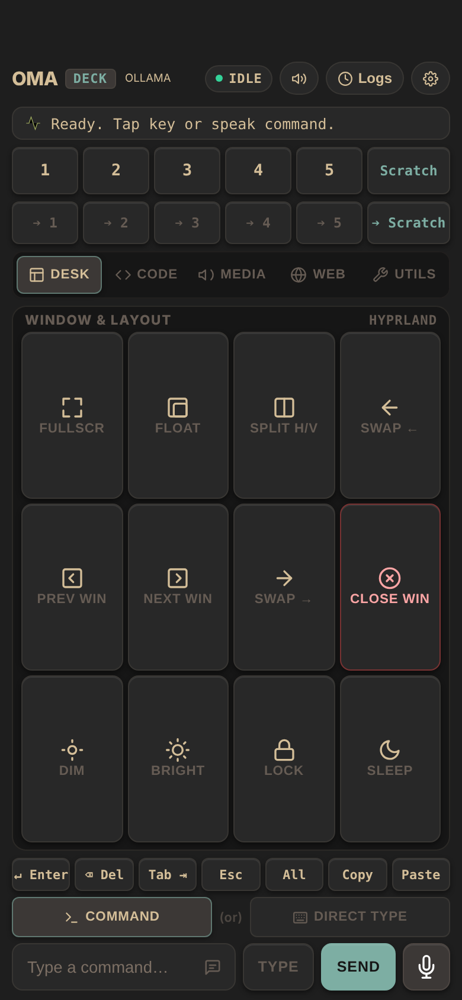

# End-to-end tests for OmaDeck

[OmaDeck](../README.md) turns a phone into a remote deck for a Hyprland
desktop: the phone opens a web page served by a Python bridge, and every key
the phone taps becomes a `hyprctl` or `wtype` call on the PC. These tests
drive that page in a phone-sized browser with [e2e](https://e2e.com)
and check what reached the desktop.



## No desktop needed

`start-deck.sh` starts the bridge with a throwaway config and a known pairing
token, and puts fake `hyprctl` and `wtype` from [`fake-desktop/`](fake-desktop)
first on its `PATH`. They write each call to `.deck/calls.log` instead of
touching a desktop, so the tests run on any Linux or macOS machine and in CI:

```ts
await screen.getByRole('button', '2').click();

await expect.poll(desktopCalls).toContain('hyprctl dispatch hl.dsp.focus({ workspace = "2" })');
```

## What they cover

[`tests/deck.e2e.ts`](tests/deck.e2e.ts), with locators:

- the pairing link opens the deck
- a workspace key switches the desktop to that workspace
- Direct Type types text into the focused PC window, then presses Enter
- the Media profile shows playback and volume keys
- the phone stays paired after the token leaves the address bar
- a tab of your own runs the key you made on it

[`tests/agentic.e2e.ts`](tests/agentic.e2e.ts), with the e2e agent: it works
out which keys to press from a plain-language goal, and each test then checks
the desktop call itself, so a pass does not rest on the model's word.

## Run

Use Python 3.11+ and Node 22.22.3+, 24.8+, or 26+. From this folder:

```bash
npm install
npm run test:e2e
```

The runner starts the bridge on `http://localhost:8799` and downloads
Chromium on the first run if needed.

## Agent tests

Set a [Vercel AI Gateway](https://vercel.com/docs/ai-gateway) key:

```bash
AI_GATEWAY_API_KEY="your-key" npm run test:e2e
```

Without the key, the agent tests skip. Results are in `.e2e/report.json`.

Last checked with e2e 0.23.0, @e2e-dev/web 0.15.5, Python 3.13, and Node 22.
